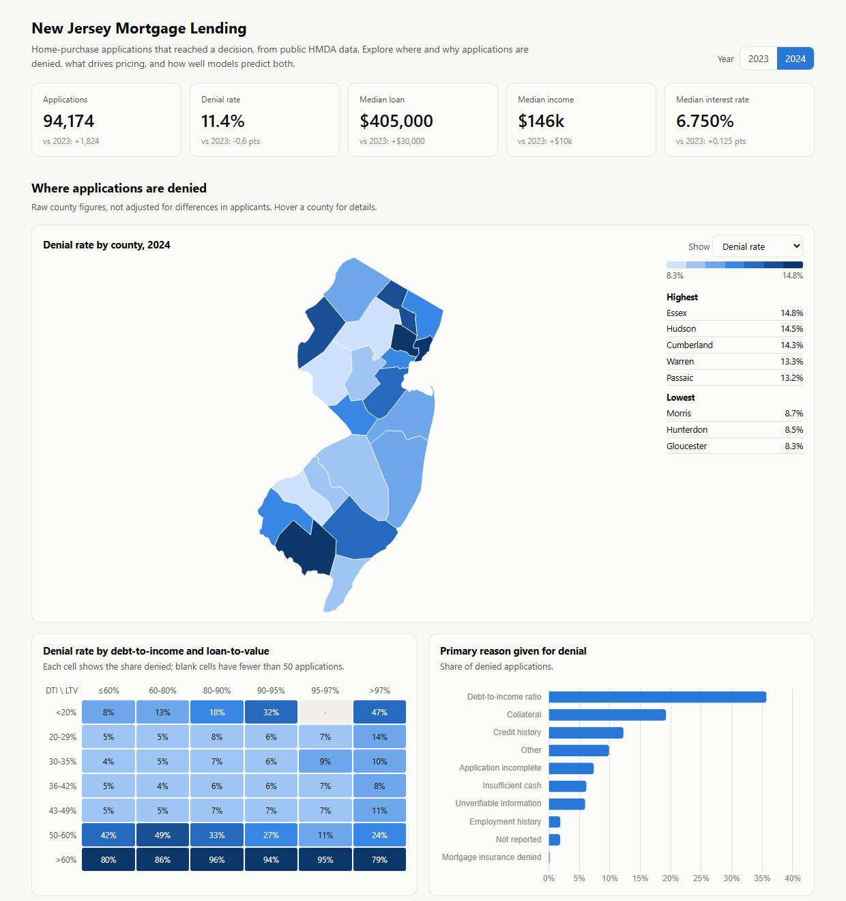
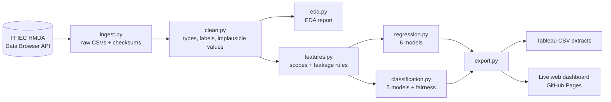

# New Jersey Mortgage Lending Analytics

An end-to-end analytics project on **186,524 real mortgage applications**: every New Jersey home-purchase application that reached a decision in 2023 and 2024, from public HMDA data. It runs ingestion → cleaning → EDA → regression → classification → fairness audit → dashboards.

**Live dashboard:** https://hkandan-hash.github.io/nj-mortgage-analytics/



| Report | What it covers |
|---|---|
| [1. Exploratory data analysis](reports/01_eda.md) | Distributions, missing data, denial patterns, geography, pricing, correlations |
| [2. Regression](reports/02_regression.md) | What drives the price a borrower pays above market: OLS, Ridge, Lasso, quantile regression, gradient boosting |
| [3. Classification](reports/03_classification.md) | Predicting denials: logistic regression, decision tree, random forest, gradient boosting; calibration; fairness audit |
| [Tableau report guide](tableau/TABLEAU_GUIDE.md) | Build and publish the Tableau Story from the exported data |

## Key findings

1. **Debt-to-income is the line that matters.** Denial rates are 6–7% for DTI between 20% and 49%, then 26% at 50–60% and 88% above 60%. DTI is also the most common reason lenders give for a denial and the strongest driver in every model.
2. **Which lender you use changes the price you pay.** Lender identity alone raises the out-of-time R² of the pricing model from 0.22 to 0.38. Holding everything else equal, investment properties pay **0.43 points** more over market, FHA loans 0.16 more, and VA loans **0.53 points less**.
3. **Denials are partly predictable a year ahead.** Trained on 2023 and tested on 2024, gradient boosting reaches ROC AUC **0.848** and average precision **0.586**, against 0.092 for a random guess. Flagging 6.7% of applications catches 47% of denials, and 65% of the flags are correct. About half of denials are not predictable from the published data, which has no credit scores.
4. **Most of the raw pricing gap between groups is explained, but not all.** Hispanic and Latino borrowers paid 29 basis points more than White borrowers on average. After accounting for loan, borrower and lender characteristics, about **4–5 bps** remains unexplained. For Black borrowers the unexplained gap is 2.8 bps. Both are statistically significant and small in dollar terms, about $100–200 a year on a $400k loan.
5. **The denial model's errors are uneven.** Without ever seeing race, the model wrongly flags approved Black applicants **3.9×** as often as approved Asian applicants (5.8% vs 1.5%), while their actual denial rates differ only 1.8×. That's acceptable for its intended use, outreach and counseling, but not for anything stricter.

## Pipeline



## Methodology choices that matter

- **Out-of-time evaluation.** Every model is trained on 2023 and tested on 2024. This is how a model would actually be used, and it's harder than a random split.
- **Pricing target is rate spread, not interest rate.** HMDA does not publish application dates, and market rates moved during 2023–24. Rate spread (APR minus the market benchmark on the lock date) removes that, so borrowers and years can be compared.
- **No target leakage.** Interest rate, pricing and denial reasons exist only after a decision, so they are excluded from the denial model. A test enforces this.
- **Missing data handled on purpose.** Denied applications are far more often missing income, LTV or DTI, because incomplete applications get denied. The models use applications with complete financials. The reports show how many rows each rule removes.
- **Protected attributes are audit-only.** Race, ethnicity, sex and age are never model inputs, and a test enforces that. They're used only for the fairness audit, because other inputs (lender, county, tract) can still correlate with them.
- **Lender as a feature, without leakage.** Lender identity is target-encoded with cross-fitting (scikit-learn `TargetEncoder`), so a training row's encoding never includes its own outcome.
- **Interpretable alongside accurate.** The OLS coefficients use HC3 robust standard errors and explicit reference categories. There are also logistic odds ratios, decision-tree rules, permutation importance and a calibration curve.

## Models

**Regression**: target is rate spread, with 56,265 training loans (2023) and 57,705 test loans (2024).

| Model | R² | RMSE |
|---|---:|---:|
| Baseline (mean) | −0.00 | 0.645 |
| OLS (HC3 errors) | 0.376 | 0.510 |
| OLS without lender | 0.217 | 0.571 |
| Ridge | 0.376 | 0.510 |
| Lasso | 0.375 | 0.510 |
| Median (quantile) regression | 0.368 | 0.513 |
| **Gradient boosting** | **0.465** | **0.472** |

**Classification**: target is denial, with 79,375 applications in 2023 (80% fit, 20% to choose thresholds) and 79,309 test applications (2024).

| Model | ROC AUC | Avg precision | Precision | Recall | F1 |
|---|---:|---:|---:|---:|---:|
| Baseline (prior) | 0.500 | 0.092 | 9.2% | 100% | 0.169 |
| Logistic regression | 0.792 | 0.439 | 50.3% | 43.4% | 0.466 |
| Decision tree (depth 5) | 0.799 | 0.489 | 73.6% | 39.8% | 0.517 |
| Random forest | 0.847 | 0.579 | 61.9% | 48.7% | 0.545 |
| **Gradient boosting** | **0.848** | **0.586** | **65.4%** | **47.4%** | **0.549** |

## Run it

Requires Python 3.12. No accounts or API keys.

```bash
python -m venv .venv
.venv\Scripts\activate            # macOS/Linux: source .venv/bin/activate
pip install -r requirements.txt

python -m mortgage.run all        # about 6 minutes: downloads ~70 MB from the HMDA API
pytest
```

Steps also run on their own: `ingest`, `clean`, `eda`, `regression`, `classification` and `export`. Open `docs/index.html` to view the dashboard locally.

CI reruns the whole pipeline from the public API on every push, so every number here can be reproduced.

## Project layout

```
mortgage/          ingest, clean, features (scopes, leakage rules), eda, regression, classification, export, charts
reports/           01_eda.md, 02_regression.md, 03_classification.md, figures/, metrics/*.json  (generated)
exports/tableau/   CSV extracts for Tableau (generated)
tableau/           Tableau Story build + publish guide
docs/              live dashboard (GitHub Pages): index.html + data.js (generated)
tests/             unit tests for parsing, scopes, leakage and protected-attribute rules, metrics
```

## Limitations

- **No credit scores in HMDA.** Credit scores drive both denials and pricing, so results here are associations, not causes. The fairness gaps can't separate unequal treatment from unmeasured credit differences.
- **Tableau Story not yet published.** It has to be published from a Tableau Public account, so it isn't live yet; follow the [guide](tableau/TABLEAU_GUIDE.md). The live dashboard above is a web version with the same content.
- **Two years, one state.** Patterns may not hold elsewhere or in different rate environments.
- **Short time gap.** Testing on 2024 shows the models hold up a year later, but performance would need ongoing monitoring if used in practice.

**Data:** Home Mortgage Disclosure Act data, FFIEC / CFPB ([Data Browser](https://ffiec.cfpb.gov/data-browser/)), which is public. County boundaries come from US Census–derived GeoJSON ([plotly/datasets](https://github.com/plotly/datasets)).

**Built with:** `Python` · `pandas` · `scikit-learn` · `statsmodels` · `matplotlib` · `Chart.js` · `Tableau` · `pytest` · `GitHub Actions` · `GitHub Pages`
