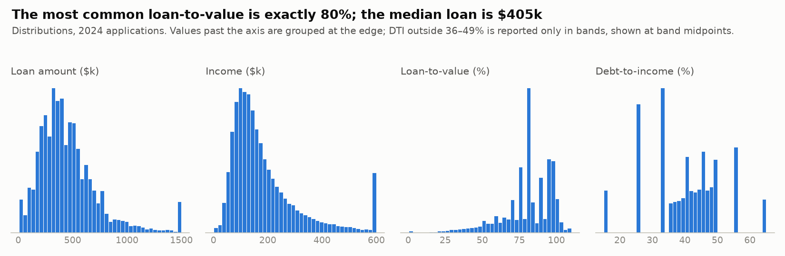
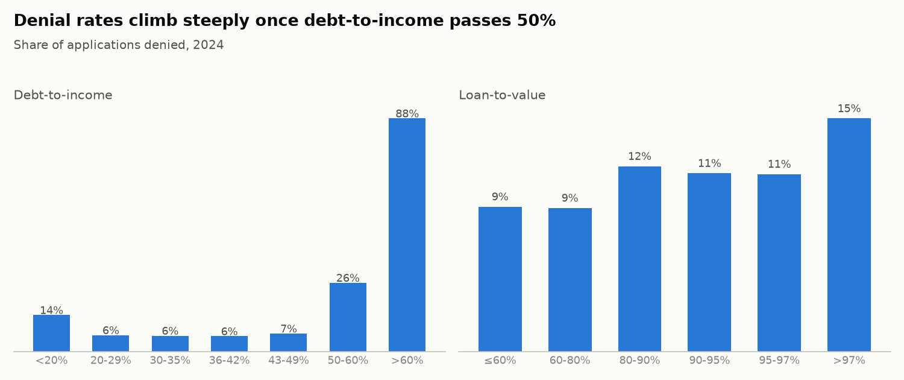
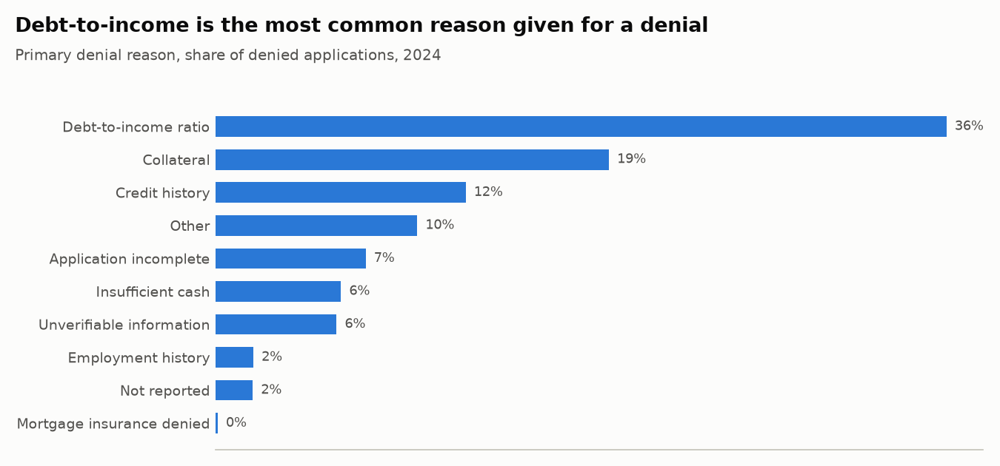
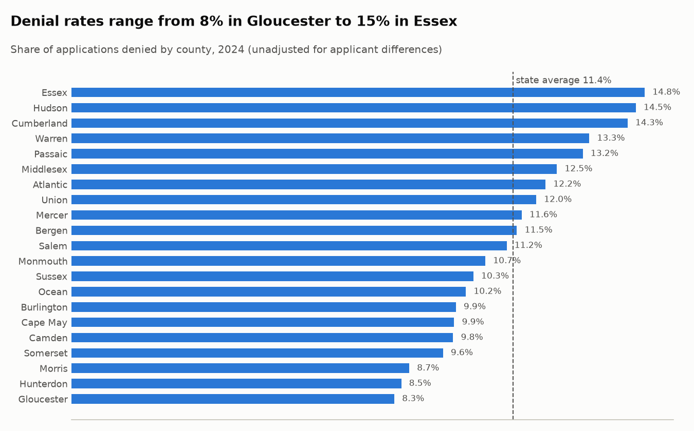
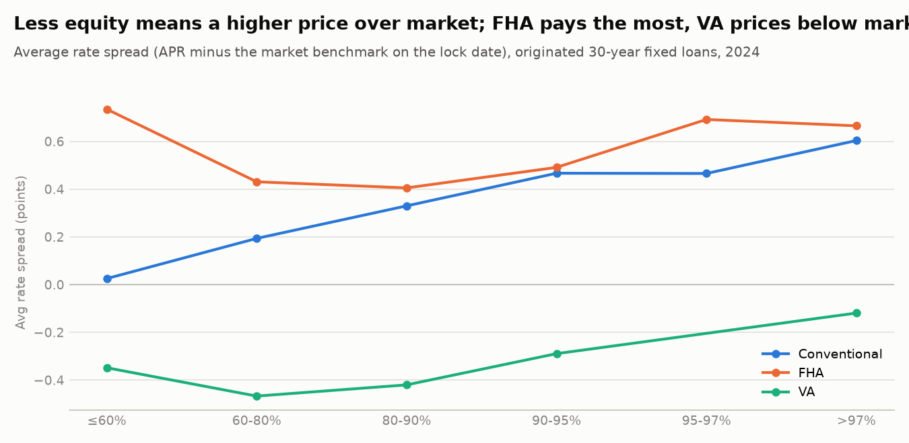
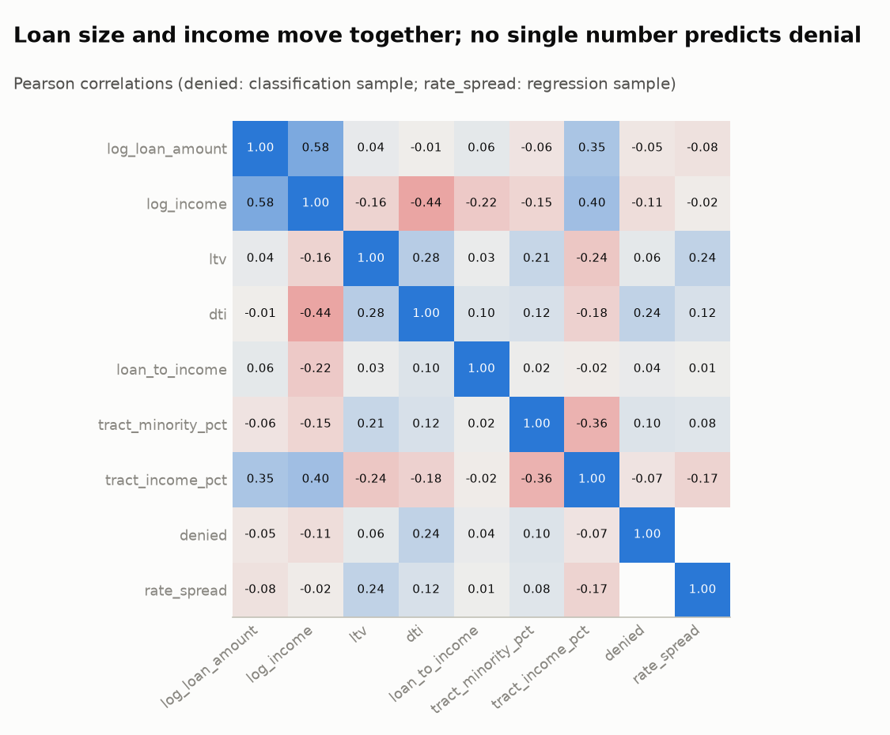

# 1. Exploratory data analysis

Home-purchase mortgage applications in New Jersey that reached a credit decision, 2023–2024 (HMDA, via the FFIEC Data Browser API). Figures are for all such applications unless stated.

## Overview

| year | applications | denial_rate | median_loan | median_income_k | median_rate |
|---|---:|---:|---:|---:|---:|
| 2023 | 92,350 | 11.9% | $375,000 | $136k | 6.625% |
| 2024 | 94,174 | 11.4% | $405,000 | $146k | 6.750% |

## Missing data

Key fields are missing far more often on denied applications, largely because incomplete applications are denied. `interest_rate` exists only for approved loans, so it can never be used to predict denial (target leakage).

| field | missing (approved) | missing (denied) |
|---|---:|---:|
| income_k | 6.7% | 10.9% |
| property_value | 2.3% | 8.5% |
| ltv | 4.5% | 12.6% |
| dti | 7.5% | 11.4% |
| loan_term_months | 1.6% | 2.6% |
| interest_rate | 3.1% | 100.0% |

## Distributions

- Loan-to-value clusters at exactly 80% (18.6% of 2024 applications), the point where private mortgage insurance is no longer required.
- Income is heavily right-skewed (mean $205k vs median $146k), so models use log income.

## What goes with denial

- Denial is lowest (6%–7%) for DTI between 20% and 49%, then jumps to 26% at 50–60% and 88% above 60%.
- Applicants with DTI under 20% are denied more often (14%) than the middle bands. They are a different mix: 21% are investors and 32% were not run through automated underwriting, vs 8% and 15% in the 20–29% band. One-variable views mislead here; the models control for these together.
- Denial rises with loan-to-value: about 9% at 80% or below, 11%–12% between 80% and 97%, and 15% above 97%.

## Why applications are denied

- The top three reasons (Debt-to-income ratio, Collateral, Credit history) cover 67.0% of denials.

## Geography

These are raw rates. Counties differ in income, loan size and lender mix, so the models below test whether location still matters once those are accounted for.

## Pricing

Rate spread removes the effect of market rates moving through the year, because HMDA does not publish application dates. That makes it the right target for comparing pricing across borrowers and years.

## Correlations

- The strongest single correlate of denial is DTI (r = 0.24); everything else is weaker. Denial depends on combinations of factors, which is why the classification models matter.
- `log_loan_amount` and `log_income` correlate at r = 0.58, so regularized models (Ridge, Lasso) are a sensible check on the plain OLS estimates.

## Unadjusted denial rates by group

Reported for transparency and examined properly in the fairness audit (`03_classification.md`). These raw gaps do not account for income, debt, loan size or credit history, and HMDA does not include credit scores.

| group | applications | denial rate |
|---|---:|---:|
| White | 42,248 | 8.2% |
| Not available | 16,066 | 13.7% |
| Asian | 13,668 | 11.0% |
| Hispanic or Latino | 13,120 | 15.8% |
| Black | 6,749 | 18.8% |
| Joint | 1,987 | 5.9% |
| Other or multiple | 336 | 17.0% |
