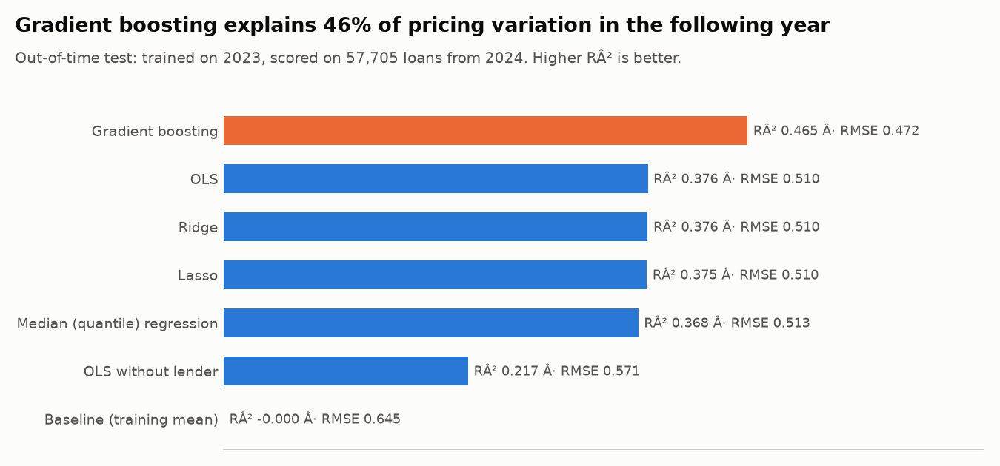
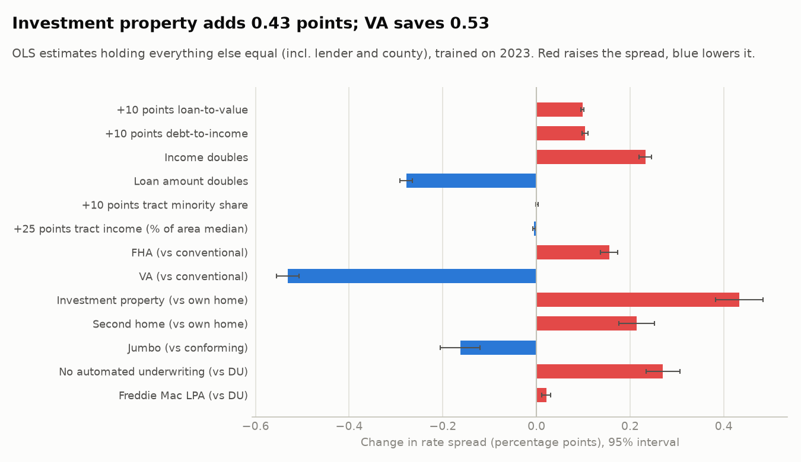
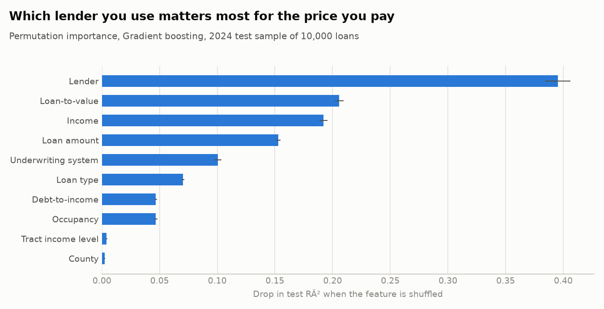
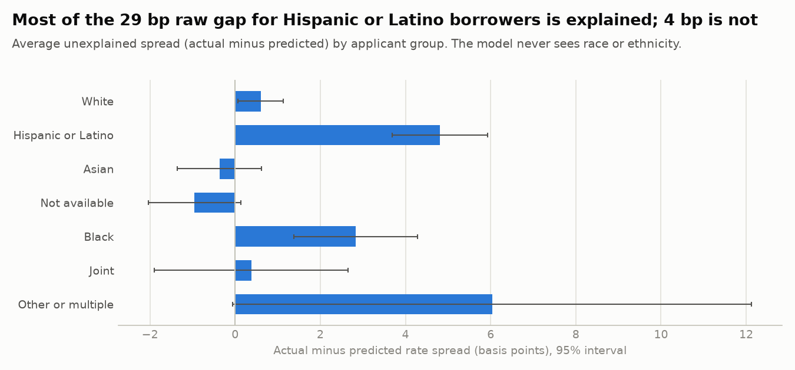

# 2. Regression: what drives mortgage pricing?

**Question.** Among borrowers who got a loan, what explains how much they paid above the market rate?

**Target.** `rate_spread`: the loan's APR minus the average prime offer rate for a comparable loan on the rate-lock date, in percentage points. Mean 0.304, standard deviation 0.645 in 2024.

**Design.** Fit on 56,265 loans from 2023; evaluated on 57,705 loans from 2024 that the models never saw. Features are loan, borrower, property, county and lender characteristics. Race, ethnicity, sex and age are excluded.

## Sample

| step | rows | removed |
|---|---:|---:|
| All applications with a credit decision | 94,174 | 0 |
| Originated | 79,924 | 14,250 |
| Not exempt from detailed reporting | 78,758 | 1,166 |
| First lien, closed-end, not reverse | 75,979 | 2,779 |
| 30-year fixed rate | 65,470 | 10,509 |
| Known county | 65,315 | 155 |
| Income, property value, LTV and DTI all reported | 60,682 | 4,633 |
| Rate spread reported and within -2 to +5 points | 57,705 | 2,977 |

## Model comparison

| model | MAE | RMSE | R2 | fit_seconds |
|---|---:|---:|---:|---:|
| Baseline (training mean) | 0.474 | 0.645 | -0.000 | 0.0 |
| OLS | 0.374 | 0.510 | 0.376 | 2.3 |
| OLS without lender | 0.410 | 0.571 | 0.217 | 1.9 |
| Ridge | 0.374 | 0.510 | 0.376 | 1.8 |
| Lasso | 0.374 | 0.510 | 0.375 | 2.0 |
| Median (quantile) regression | 0.374 | 0.513 | 0.368 | 54.7 |
| Gradient boosting | 0.347 | 0.472 | 0.465 | 6.7 |

- **Gradient boosting** performs best (R² 0.465 on next year's loans); the linear models trail it, so pricing has non-linear patterns and interactions.
- Lasso kept 31 of 48 features (alpha 0.0004), and Ridge and Lasso score almost the same as OLS. With this many observations, regularization adds little, which suggests OLS is not overfitting.
- **Lender identity explains a large share of pricing.** OLS reaches R² 0.376 with the lender feature and 0.217 without it. Two similar borrowers can pay noticeably different prices depending on where they apply.

## What moves the price

| change | effect (pct. points) | 95% interval |
|---|---:|---:|
| +10 points loan-to-value | +0.098 | ±0.003 |
| +10 points debt-to-income | +0.104 | ±0.006 |
| Income doubles | +0.233 | ±0.013 |
| Loan amount doubles | -0.278 | ±0.014 |
| +10 points tract minority share | +0.001 | ±0.003 |
| +25 points tract income (% of area median) | -0.005 | ±0.004 |
| FHA (vs conventional) | +0.155 | ±0.019 |
| VA (vs conventional) | -0.531 | ±0.024 |
| Investment property (vs own home) | +0.433 | ±0.051 |
| Second home (vs own home) | +0.214 | ±0.038 |
| Jumbo (vs conforming) | -0.163 | ±0.043 |
| No automated underwriting (vs DU) | +0.270 | ±0.036 |
| Freddie Mac LPA (vs DU) | +0.021 | ±0.010 |

Effects are from OLS with heteroskedasticity-robust (HC3) standard errors, holding all other features (including lender and county) fixed. Associations, not causal effects: HMDA has no credit scores, which drive pricing and correlate with several of these features.

Two rows need care when reading:
- *Loan amount doubles* lowers the spread largely for a mechanical reason: rate spread is based on APR, which includes fixed closing costs, and those costs weigh more on a small loan.
- *Income doubles* is estimated with debt-to-income held fixed, which means debts double too. It is not evidence that higher earners pay more.

## Feature importance

## Pricing gaps by group

| group | loans | actual spread | predicted | raw gap vs White (bps) | unexplained (bps) | 95% interval (bps) |
|---|---:|---:|---:|---:|---:|---:|
| White | 28,317 | 0.253 | 0.247 | +0.0 | +0.6 | ±0.5 |
| Hispanic or Latino | 8,599 | 0.547 | 0.499 | +29.4 | +4.8 | ±1.1 |
| Asian | 7,679 | 0.146 | 0.149 | -10.7 | -0.4 | ±1.0 |
| Not available | 7,279 | 0.304 | 0.313 | +5.1 | -1.0 | ±1.1 |
| Black | 4,217 | 0.458 | 0.430 | +20.5 | +2.8 | ±1.4 |
| Joint | 1,400 | 0.225 | 0.221 | -2.8 | +0.4 | ±2.3 |
| Other or multiple | 214 | 0.355 | 0.295 | +10.2 | +6.0 | ±6.1 |

- Hispanic or Latino borrowers paid 29 bps more than White borrowers on average; after accounting for loan, borrower and lender characteristics, 4.2 bps of that difference remains unexplained.
- Groups with an unexplained spread significantly different from zero (95% level, at least 1,000 loans): Hispanic or Latino (+4.8 bps), Black (+2.8 bps). On a $400,000 loan, 5 bps is roughly $200 a year in interest.

Unexplained gap = average actual spread minus the model's prediction for that group. 1 basis point = 0.01 percentage points. Without credit scores this cannot separate unequal treatment from unmeasured credit differences; a gap near zero means the observed loan and lender characteristics account for the average pricing difference.
