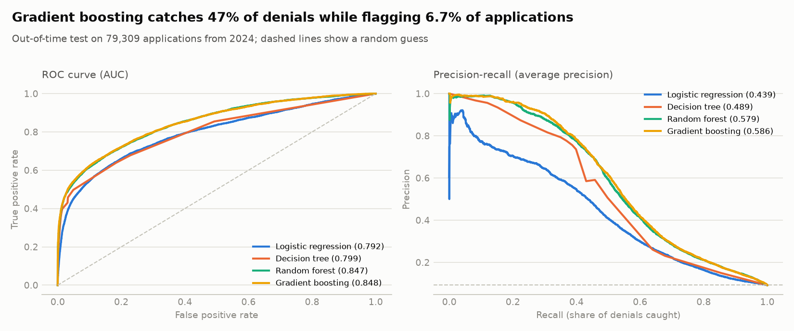
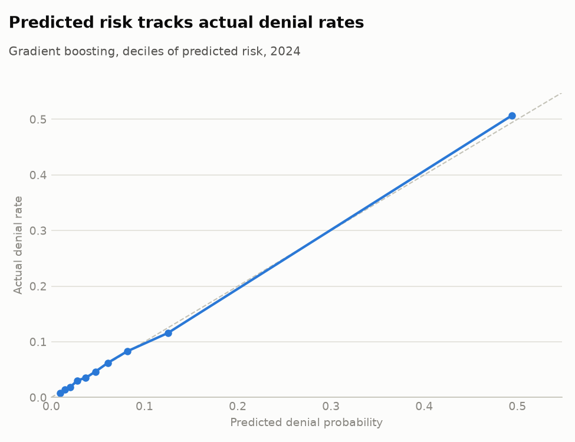
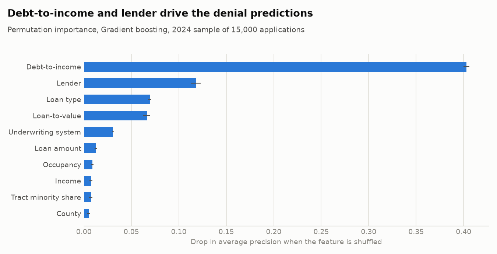
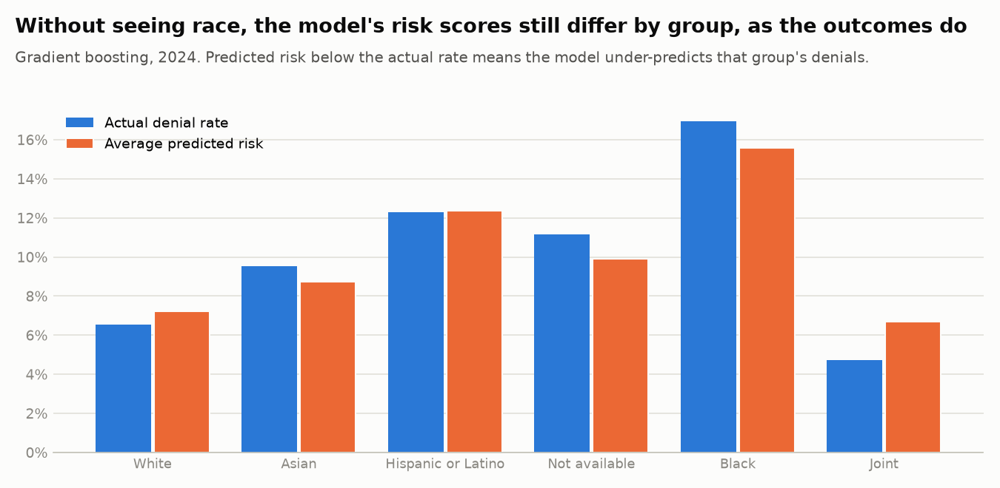

# 3. Classification: predicting mortgage denials

**Question.** Using only what is known when an application is decided, how well can we predict a denial?

**Intended use.** An early-warning flag so a loan officer or housing counselor can contact likely-to-be-denied applicants and help them fix the issue (paying down debt, a larger down payment, a different loan program). Not for making or automating credit decisions.

**Design.** Fit on 80% of 2023 applications; the other 20% chooses each model's decision threshold (maximum F1). Everything is then scored on 79,309 applications from 2024. Race, ethnicity, sex and age are never inputs. Interest rate, pricing and denial-reason fields are excluded because they only exist after the decision.

Denial rate in scope: 9.2% (2024). Accuracy is not reported: predicting "approve" for everyone would be 90.8% accurate and useless.

## Sample

| step | rows | removed |
|---|---:|---:|
| All applications with a credit decision | 94,174 | 0 |
| Not exempt from detailed reporting | 92,770 | 1,404 |
| Closed-end, not a reverse mortgage | 90,320 | 2,450 |
| Known county | 89,811 | 509 |
| Income, property value, LTV and DTI all reported | 79,309 | 10,502 |

## Model comparison



| model | ROC AUC | PR AUC | Brier | Log loss | Threshold | Precision | Recall | F1 | Flagged | fit_seconds |
|---|---:|---:|---:|---:|---:|---:|---:|---:|---:|---:|
| Baseline (training denial rate) | 0.500 | 0.092 | 0.0836 | 0.307 | 0.09 | 9.2% | 100.0% | 0.169 | 100.0% | 0.0 |
| Logistic regression | 0.792 | 0.439 | 0.0661 | 0.245 | 0.23 | 50.3% | 43.4% | 0.466 | 7.9% | 2.2 |
| Decision tree | 0.799 | 0.489 | 0.0589 | 0.224 | 0.31 | 73.6% | 39.8% | 0.517 | 5.0% | 2.0 |
| Random forest | 0.847 | 0.579 | 0.0573 | 0.214 | 0.24 | 61.9% | 48.7% | 0.545 | 7.3% | 23.1 |
| Gradient boosting | 0.848 | 0.586 | 0.0548 | 0.206 | 0.27 | 65.4% | 47.4% | 0.549 | 6.7% | 6.2 |

- **Gradient boosting** is best on the metric that matters for a rare outcome, average precision (0.586, vs 0.092 for a random guess). ROC AUC is 0.848.
- At its threshold (0.27), it flags 6.7% of applications and catches 47% of denials; 65% of flagged applications are actually denied.
- Confusion matrix (2024): 3,459 denials caught, 3,841 missed, 1,834 approved applications flagged, 70,175 correctly left alone.
- Logistic regression trails (average precision 0.439). Denial depends on thresholds and interactions, such as debt-to-income above about 50% and lender-specific practices (see the tree rules below), that a linear model cannot represent. Its odds ratios are still useful for explaining direction.

## Calibration



Brier score 0.0548. If the points follow the diagonal, a predicted 30% risk means about 30% of such applications are denied, so the score can be read as a probability.

## What drives the predictions



Logistic regression odds ratios (above 1 raises the odds of denial; numeric features are per standard deviation):

| feature | odds_ratio |
|---|---:|
| aus = Internal proprietary system | 3.71 |
| dti | 2.57 |
| aus = No AUS used | 2.26 |
| lender (target-encoded) | 1.91 |
| occupancy = Investment property | 1.73 |
| conforming = Jumbo | 1.28 |
| credit_score_model = Other model | 0.40 |
| manufactured | 0.51 |
| loan_type = VA | 0.51 |
| loan_type = USDA | 0.65 |

Top of the depth-5 decision tree, as readable rules:

```
|--- dti <= 60.0
|   |--- lender (target-encoded) <= 0.3
|   |   |--- dti <= 52.0
|   |   |   |--- lender (target-encoded) <= 0.1
|   |   |   |   |--- truncated branch of depth 2
|   |   |   |--- lender (target-encoded) >  0.1
|   |   |   |   |--- truncated branch of depth 2
|   |   |--- dti >  52.0
|   |   |   |--- loan_type = Conventional <= 0.5
|   |   |   |   |--- truncated branch of depth 2
|   |   |   |--- loan_type = Conventional >  0.5
|   |   |   |   |--- truncated branch of depth 2
|   |--- lender (target-encoded) >  0.3
|   |   |--- dti <= 43.5
|   |   |   |--- ltv <= 81.8
|   |   |   |   |--- truncated branch of depth 2
|   |   |   |--- ltv >  81.8
|   |   |   |   |--- class: 0
|   |   |--- dti >  43.5
|   |   |   |--- class: 1
|--- dti >  60.0
|   |--- ltv <= 98.6
|   |   |--- aus = No AUS used <= 0.5
|   |   |   |--- lender (target-encoded) <= 0.1
|   |   |   |   |--- class: 1
|   |   |   |--- lender (target-encoded) >  0.1
|   |   |   |   |--- truncated branch of depth 2
|   |   |--- aus = No AUS used >  0.5
|   |   |   |--- class: 1
|   |--- ltv >  98.6
|   |   |--- class: 1
```

## Fairness audit



| group | applications | actual denial rate | avg predicted | flagged | false positive rate | false negative rate |
|---|---:|---:|---:|---:|---:|---:|
| White | 37,149 | 6.5% | 7.2% | 4.8% | 2.0% | 54.5% |
| Asian | 12,209 | 9.5% | 8.7% | 5.4% | 1.5% | 57.8% |
| Hispanic or Latino | 11,356 | 12.3% | 12.4% | 9.7% | 3.8% | 48.1% |
| Not available | 10,442 | 11.2% | 9.9% | 7.9% | 3.0% | 53.2% |
| Black | 6,033 | 17.0% | 15.6% | 13.8% | 5.8% | 47.3% |
| Joint | 1,825 | 4.7% | 6.7% | 3.5% | 1.6% | 59.3% |

| group | applications | actual denial rate | avg predicted | flagged | false positive rate | false negative rate |
|---|---:|---:|---:|---:|---:|---:|
| Joint | 32,533 | 6.8% | 7.5% | 4.6% | 1.8% | 55.9% |
| Male | 26,525 | 10.6% | 10.2% | 7.9% | 3.2% | 52.1% |
| Female | 16,208 | 10.8% | 10.4% | 8.0% | 3.0% | 50.5% |
| Not available | 4,043 | 12.6% | 11.2% | 9.4% | 3.3% | 48.3% |

- **False positive rates differ 3.9×.** Approved Black applicants are wrongly flagged 5.8% of the time vs 1.5% for Asian applicants. Their actual denial rates differ by less (17.0% vs 9.5%, 1.8×), so the gap is not just a base-rate effect: approved Black applicants more often share the profile the model associates with denial. A flag used for outreach costs a phone call; used for anything stricter, this disparity would be a serious problem and would need mitigation (e.g. group-aware threshold review).
- False negative rates are high for every group (47%–59%): about half of denials are not predictable from the published application data.
- The model under-predicts denials for: Asian (8.7% predicted vs 9.5% actual), Not available (9.9% predicted vs 11.2% actual), Black (15.6% predicted vs 17.0% actual). Part of their denial risk is not captured by the published data, plausibly credit history, which HMDA does not include.
- Excluding race from the inputs does not make a model fair by itself: lender, county and tract features correlate with it. That is why this audit reports outcomes by group instead of assuming neutrality.
