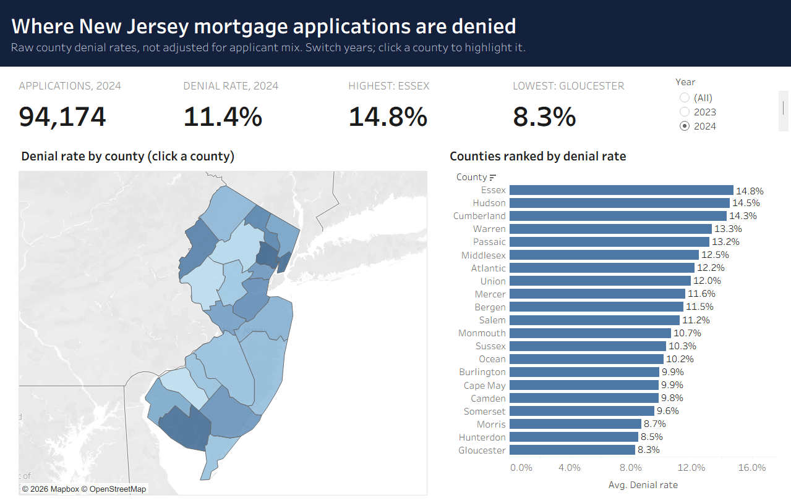

# Tableau report

[`NJ_Mortgage_Lending.twbx`](NJ_Mortgage_Lending.twbx) is a ready-to-open Tableau workbook. It contains a **Story with five story points**, each a designed dashboard.

| # | Dashboard | Finding |
|---|---|---|
| 1 | Where | 1 in 9 NJ purchase applications is denied; rates range from 8.3% (Gloucester) to 14.8% (Essex). Filled county map, ranked bars, and a year control. |
| 2 | Why | Denials take off once debt-to-income passes 50% (6–7% for DTI 20–49%, 26% at 50–60%, 88% above 60%). DTI × LTV heatmap and denial reasons. |
| 3 | Pricing | Lender choice and equity drive what borrowers pay over market. Regression effects, model comparison, and drivers. |
| 4 | Prediction | Gradient boosting catches 47% of denials while flagging 6.7% of applications. ROC curves, model comparison, risk bands, and drivers. |
| 5 | Fairness | Most pricing gaps are explained; the flag's errors are uneven across groups. Dot plots and gap chart. |



## Publish it to Tableau Public (about 5 minutes)

1. Install the free [Tableau Public](https://public.tableau.com/app/discover) app and sign in.
2. Open `NJ_Mortgage_Lending.twbx`. It opens on the Story.
3. Choose **File → Save to Tableau Public As…**, name it *NJ Mortgage Lending*, and sign in if asked.
4. In the browser page that opens, copy the URL. Under **Settings**, make sure *Show Viz on Profile* is on.

Every data source is a Hyper extract, which Tableau Public requires, so no extra steps are needed.

## Design

- **Layout:** each dashboard has a dark header band with the headline, then a row of KPI tiles, then white chart cards on a light grey canvas, with a source line at the bottom.
- **Type:** Tableau's own fonts (Semibold headings, Book body, Light subtitles), which render the same everywhere on Tableau Public.
- **Color:** one blue for single series, and orange to highlight what matters: the best model, a significant gap, or a price increase. Sequential blue is used for rates on the map and heatmap.
- **Interactivity:**
  - hover tooltips on every mark
  - a year control on the map dashboard
  - click a county to highlight it on the map and in the ranking, and click a group to highlight it across the fairness charts
  - story navigation along the top
- **Truthful by construction:** headlines, KPI tiles and story captions are computed from the same metrics files as the reports, so the numbers always match.

## Rebuild it

The workbook is generated by [`build_workbook.py`](build_workbook.py) from the exported data, so it can be regenerated after any change to the analysis:

```bash
pip install -r requirements-tableau.txt     # Tableau Hyper API
python -m mortgage.run export               # refresh exports/tableau/*.csv and metrics
python tableau/build_workbook.py            # writes NJ_Mortgage_Lending.twbx (+ a local .twb)
```

The generator writes typed Hyper extracts for each CSV and the workbook XML (data sources, 34 worksheets, 5 dashboards, the Story and the highlight actions), then packages them into the `.twbx`. Each version was checked by opening it in Tableau Public 2026.3: Tableau validates the file against its schema and logs any errors on load.

## Building it by hand instead

All data is in [`exports/tableau/`](../exports/tableau/) as CSV if you'd rather build your own version. Use these numbers to check yours:

| Check | Value |
|---|---|
| 2024 applications / denial rate | 94,174 / 11.4% |
| Highest and lowest county denial rate, 2024 | Essex 14.8%, Gloucester 8.3% |
| DTI 50–60% denial rate, 2024 | 26% (6–7% for DTI 20–49%) |
| Best regression model (out-of-time R²) | Gradient boosting, 0.465 |
| Best classifier (ROC AUC / average precision) | Gradient boosting, 0.848 / 0.586 |
